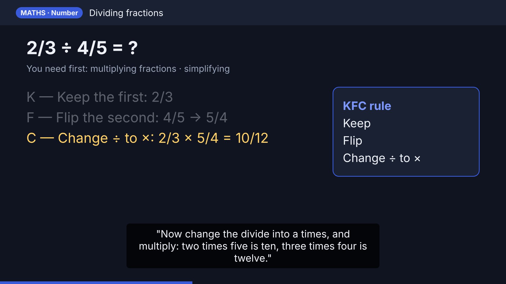

# Video Lesson Plan (for approval)

> **Status: approved, with Option A (natural voice).** The videos are in `videos/`. The voice is Piper "Jenny" (British English).

## 1. What you will get

**Two videos** (MP4, 1080p, they play on any phone or laptop):

| Video | Length (approx.) | Chapters |
|---|---|---|
| **Chemistry Paper 2 (Edexcel)** | 14 min | Key concepts · Group 1 · Groups 7 & 0 · Rates · Energy changes · Fuels · Atmosphere · Triple-only extras · Recap |
| **Maths Paper 1** | 21 min | Number · Algebra · Ratio · Geometry · Probability · Statistics · 2-minute recap |

They are split into two videos so you can watch the one you need, when you need it. Each video has **chapter markers**, so you can jump straight to a topic.

## 2. How each scene works (voice and screen in sync)

The main rule: **the screen shows exactly what the voice is saying, at the moment it says it.**

- Each topic is broken into short **steps** (one sentence or one line of working).
- When the voice starts a step, **that line appears on screen and is highlighted in yellow**. Earlier lines stay but fade to grey, so you can see how you got there.
- Worked examples are built **line by line**, the way a teacher writes on the board. The voice never talks about something that isn't on screen.
- Each maths topic opens with a **"You need first:"** line, showing which earlier idea it builds on.
- A **key-rule box** on the right holds the rule being used (for example KFC, SOH CAH TOA, or the gas tests).
- **Subtitles** at the bottom show the spoken words, so you can follow even with the sound off.
- A **progress bar** along the bottom shows how far through the video you are.
- **Diagrams** are drawn where they help: rate graphs, the fractionating column, the greenhouse effect, a Venn diagram, a tree diagram, right-angled triangles, circle theorems.
- After every section there is a **"Pause and try"** question (5 seconds on screen), then the answer.

**Sample frame** (from "Dividing fractions"): `video-plan-sample-frame.png`

## 3. The voice

- **Accent:** British English, so words like "aluminium" and "sulfur" sound the way you hear them in class.
- **Pace:** slow and clear (about 140 words per minute), with a short pause after every step so you can read the screen.
- **Numbers are read the way a teacher says them.** For example "x squared" (not "x two"), "two-thirds", "root three", "C-O-two", "H-two-O".
- The script uses the same simple words as the revision guide.

**One technical point:** the clearest, most natural voices are AI voice models that I have to download. This session's network currently blocks the site they come from (`huggingface.co`). There are two options:
- **Option A (recommended):** you allow that one website for this session. You'll get an approval pop-up, and I'll use a natural-sounding British neural voice (Piper). This runs entirely on this machine and is free.
- **Option B:** I use the robotic voice that's already installed (eSpeak). It is understandable but sounds like a robot. **I don't recommend it** for a long lesson.

I'll send you a **30-second voice sample** for your approval before making the full videos.

## 4. How I'll make it (technical)

1. Write a **script** for each scene: the narration lines plus what appears on screen for each line. The script is taken from the revision guide, so the content matches.
2. Turn each narration line into audio, then measure exactly how long each line takes.
3. Build each screen as a web page and capture it as images at 1920×1080. Each line is shown for exactly as long as its audio lasts, so the picture and voice stay in sync.
4. Join everything together with **ffmpeg** into an MP4, adding subtitles (a `.srt` file too) and chapter markers.
5. Check the videos myself: watch frames from every chapter, check the sync, and check the maths.
6. Save the videos to this folder on the branch, along with the scripts so they can be edited later.

## 5. What I need from you

1. **Approve the plan** (or tell me what to change: length, style, colours, one video instead of two…).
2. **Choose the voice option:** A (natural, needs one website allowed) or B (robotic, works now).
